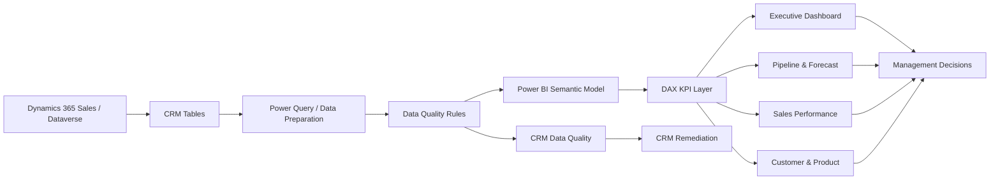
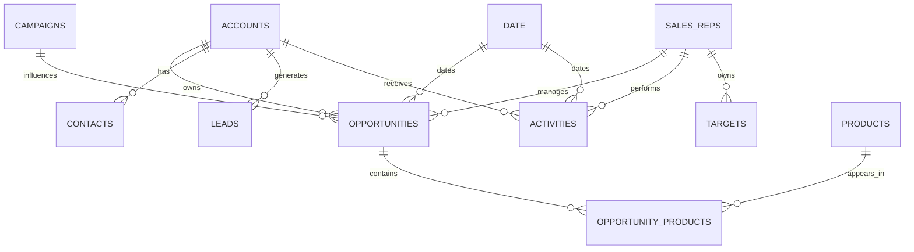

# Dynamics 365 CRM Commercial Analytics | Power BI

> **From CRM records to commercial decisions: pipeline, forecast, sales productivity, and data quality in one operating view.**


## 1. Executive summary

This project demonstrates how a commercial analyst can turn Dynamics 365-style CRM data into a management decision system in Power BI.

The solution answers five executive questions:

1. **How much business is already won?**
2. **How much pipeline is available, and how much is realistically forecastable?**
3. **Where is pipeline risk concentrated?**
4. **Which sales teams, customers and segments require intervention?**
5. **Can management trust the CRM data behind the numbers?**

## 2. Business problem

CRM systems can contain thousands of leads, accounts, activities and opportunities. A sales manager may have plenty of records but still lack a clear answer to:

- What is the true pipeline?
- Is the forecast credible?
- Which opportunities are ageing?
- Which reps are converting pipeline into revenue?
- Are activities translating into commercial outcomes?
- Which CRM records need correction before they affect reporting?

The project solves this by creating a layered analytics model:

**CRM data → quality controls → semantic model → commercial KPIs → diagnostics → management action**

## 3. Business questions

### Executive
- What are won revenue, open pipeline and weighted pipeline?
- Are we achieving revenue targets?
- How much pipeline coverage exists against target?
- Which industries, segments and territories drive revenue?

### Pipeline
- Where is pipeline concentrated by stage?
- Which opportunities are high-value but low-probability?
- Which opportunities are ageing beyond the expected sales cycle?
- What is expected to close by month?

### Sales productivity
- Which sales reps generate revenue consistently?
- What is win rate and average deal size by rep?
- Are activities concentrated on active opportunities?
- Where are activity-to-opportunity gaps visible?

### CRM governance
- Are opportunity IDs unique?
- How many opportunities have no owner?
- How many opportunities lack expected close dates?
- How many have zero or invalid revenue?
- What is the overall data completeness rate?

## 4. KPI framework

| KPI | Business meaning |
|---|---|
| Won Revenue | Revenue from closed-won opportunities |
| Total Pipeline | Open opportunity value |
| Weighted Pipeline | Pipeline adjusted by opportunity probability |
| Win Rate | Won opportunities / closed opportunities |
| Average Deal Size | Won revenue / won opportunities |
| Pipeline Coverage | Open pipeline / revenue target |
| Target Achievement | Won revenue / target |
| Open Opportunities | Active opportunities not won/lost |
| Opportunity Age | Days an opportunity has remained open |
| Activities per Opportunity | Sales engagement intensity |
| At-Risk Pipeline | Low-probability open pipeline |
| Data Completeness | CRM records passing defined quality checks |


## 6. Architecture



Microsoft documents Dataverse as the data platform behind Dynamics 365 Sales and supports direct Power BI reporting through the Dataverse connector. [Microsoft Learn: Create a Power BI report using Dataverse](https://learn.microsoft.com/en-us/power-apps/maker/data-platform/data-platform-powerbi-connector) and [Dynamics 365 Sales Developer Guide](https://learn.microsoft.com/en-us/dynamics365/sales/developer/developer-guide)

## 7. Semantic model



### Recommended modeling principle

Use dimensions for reusable business context and facts for events/measures. The production-style pattern is a star schema rather than simply importing every CRM table and relying on automatic relationships.

## 8. Data volumes

| Table | Rows | Role |
|---|---:|---|
| Accounts | 500 | Dimension |
| Contacts | 1,500 | Dimension / customer detail |
| SalesReps | 50 | Dimension |
| Products | 100 | Dimension |
| Campaigns | 30 | Dimension |
| Leads | 5,000 | Fact |
| Opportunities | 15,000 | Fact |
| OpportunityProducts | 28,911 | Fact |
| Activities | 40,000 | Fact |
| Targets | 1,650 | Fact |
| Date | 1,096 | Dimension |

## 9. Intentional data-quality issues

The project deliberately contains:

- 35 duplicate opportunity IDs
- 120 opportunities with missing sales reps
- 180 opportunities with missing expected close dates
- 25 opportunities with an invalid stage value
- 40 opportunities with zero estimated revenue

This is deliberate. A commercial analytics solution should demonstrate that the analyst understands **data trust**, not only visualization.

## 10. Power BI build steps

1. Open Power BI Desktop.
2. Get Data → Text/CSV.
3. Load the CSVs under `data/raw/`.
4. Set correct data types.
5. Create the relationships documented in `powerbi/Semantic_Model.md`.
6. Mark `Date` as the date table.
7. Add the measures from `powerbi/DAX_Measures.dax`.
8. Apply `powerbi/CRM_Commercial_Analytics_Theme.json`.
9. Build the five report pages.
10. Add drill-through from rep/account/opportunity views.
11. Add conditional formatting for at-risk pipeline and data-quality exceptions.
12. Publish the report to Power BI Service.
13. Configure workspace permissions and refresh.

Microsoft's current guidance supports connecting Power BI Desktop directly to Dataverse, transforming tables, and publishing reports to Power BI. citeturn0search0turn0search2

## 11. Production Dynamics 365 implementation

For a real implementation, replace the CSV layer with Dataverse/Dynamics 365 Sales tables such as Accounts, Contacts, Leads, Opportunities and Products. Dynamics 365 Sales runs on Dataverse and exposes Sales tables through the platform. citeturn0search5turn0search12

Typical production flow:

**Dynamics 365 Sales → Dataverse → Power BI semantic model → Power BI Service → embedded/shared report**

Microsoft also documents Power BI visualization embedding within model-driven Power Apps / Dynamics 365 experiences. [Microsoft Learn: Use Power BI](https://learn.microsoft.com/en-us/power-platform/admin/use-power-bi)

## 12. Expected business impact

Because this is a synthetic portfolio project, the following are **targeted business outcomes, not claimed real client results**:

- Reduce manual weekly pipeline reporting effort.
- Establish a single definition for commercial KPIs.
- Improve forecast discipline using weighted pipeline.
- Prioritize stale, high-value and low-probability opportunities.
- Give managers rep-level target and execution visibility.
- Create a repeatable CRM data-quality control layer.
- Move sales reviews from record collection to exception-based management.


## 14. Repository structure

```text
Dynamics365-CRM-Commercial-Analytics/
├── .github/
│   └── workflows/
├── articles/
│   └── medium-crm-analytics.md
├── dashboard/
│   └── Dashboard_Specification.md
├── data/
│   └── raw/
├── docs/
│   ├── Business_Case.md
│   ├── Architecture.md
│   ├── Data_Model.md
│   ├── KPI_Dictionary.md
│   └── Implementation_Guide.md
├── powerbi/
│   ├── DAX_Measures.dax
│   ├── Semantic_Model.md
│   └── CRM_Commercial_Analytics_Theme.json
├── src/
│   └── README.md
├── scripts/
│   └── README.md
├── .gitignore
├── LICENSE
└── README.md
```


**Dynamics 365 CRM Commercial Analytics | Power BI | Sales Pipeline & Forecast Intelligence**

Skills demonstrated:

`Power BI` `DAX` `Power Query` `SQL concepts` `CRM Analytics` `Commercial Analytics` `Sales Analytics` `Data Modeling` `Data Quality` `Forecasting` `KPI Design` `Dynamics 365` `Dataverse`
