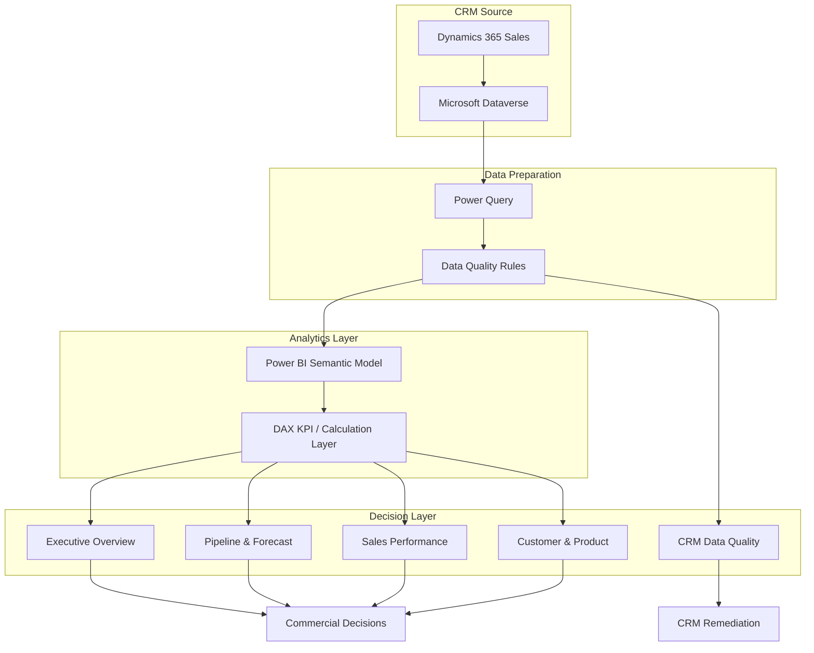

# Architecture

## Source layer

Dynamics 365 Sales uses Dataverse for its application data. Typical Sales entities/tables include accounts, contacts, leads, opportunities and products. citeturn0search5

## Preparation layer

For a portfolio implementation, CSVs simulate Dataverse tables. In production, use the Dataverse connector in Power BI. Microsoft identifies the Dataverse connector as the current Power BI path for analytics workloads involving Dataverse data. [Microsoft Learn: Power Query Dataverse connector](https://learn.microsoft.com/en-us/power-query/connectors/dataverse)

## Semantic layer

The semantic model separates dimensions and facts so that KPI calculations remain reusable across the report.

## Decision layer

The dashboard is designed around decisions, not chart types:

- Forecast / pipeline decisions
- Sales manager interventions
- Account prioritization
- Target management
- CRM remediation
